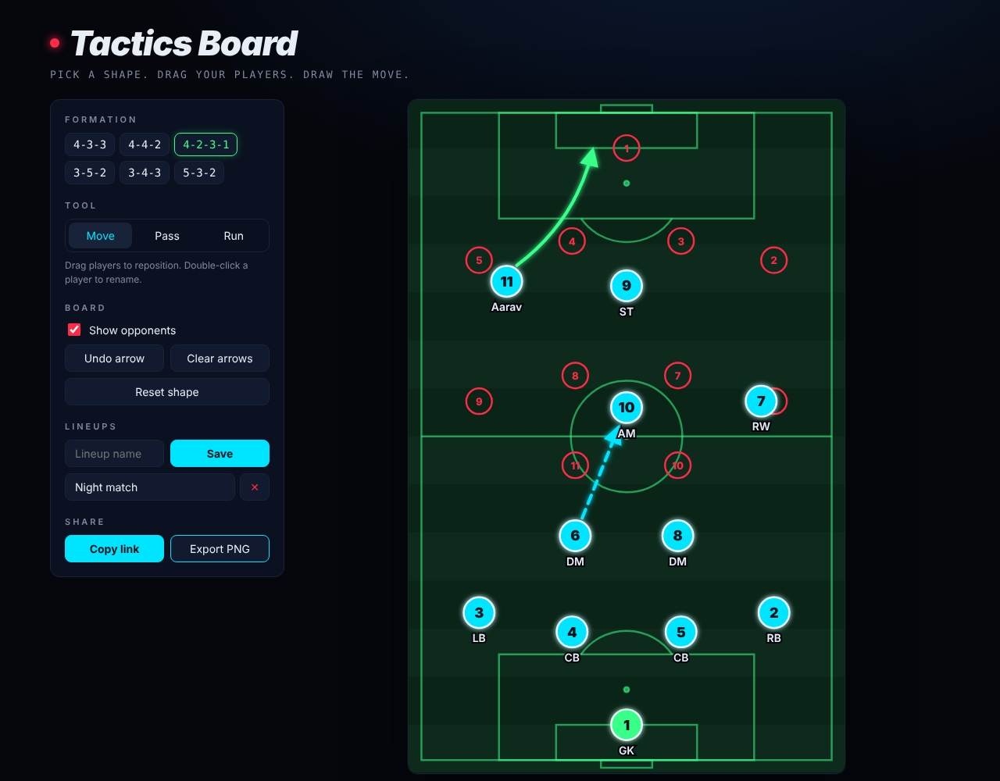

<div align="center">

# ⚽ Tactics Board

**Pick a shape. Drag your players. Draw the move.**

A neon football tactics board that runs in the browser. Choose a formation, move your players, draw passes and runs, then save the lineup, share it as a link or export it as an image.

[**▶ Open the live board**](https://aaravcodesss.github.io/tactics-board/)



</div>

## Features

- **6 formations**: 4-3-3, 4-4-2, 4-2-3-1, 3-5-2, 3-4-3 and 5-3-2. Switching shape keeps your custom names and numbers.
- **Drag & drop players** with mouse or touch (it uses Pointer Events, so it works on phones too).
- **Draw the move.** Passes are dashed cyan arrows and runs are curved green arrows. Arrows snap to players and stop at their edge.
- **Rename players.** Double-click or double-tap a player, or press Enter on one, to set a name and shirt number.
- **Opponents overlay**: toggle a red 4-4-2 to plan against.
- **Save lineups** in your browser (`localStorage`).
- **Share by link.** The whole board is encoded into the URL, so there's no backend needed.
- **Export as PNG** at 2× resolution, ready for the group chat.
- **Keyboard shortcuts**: `M` move · `P` pass · `R` run · `Ctrl/Cmd + Z` undo arrow.

## How it works

| Piece | What it does |
|:--|:--|
| `index.html` | Layout, plus the pitch drawn as an SVG (680 × 1050 units, a scaled-down real pitch) |
| `formations.js` | Player coordinates for every formation |
| `app.js` | State, rendering, pointer handling, saving, share links and PNG export |
| `style.css` | Neon theme, responsive layout |

- **One state object** (`formation`, `players`, `arrows`, `showOpp`) is the single source of truth. Every change updates it and calls `render()`.
- **Screen → pitch coordinates** use `getScreenCTM().inverse()`, so dragging stays accurate at any zoom or screen size.
- **Share links** compact the state to arrays, then encode it as URL-safe base64 in `location.hash`. The data never leaves your browser.
- **PNG export** clones the SVG, inlines its styles, draws it onto a `<canvas>` and downloads it.

No frameworks and no build step: just open `index.html`.

## Run locally

```bash
git clone https://github.com/Aaravcodesss/tactics-board.git
cd tactics-board
python3 -m http.server 8000   # or just open index.html
```

Then visit <http://localhost:8000>.

## Ideas for next

- [ ] Animate a move step by step (play / pause)
- [ ] Custom team colours
- [ ] Multiple frames per tactic
- [ ] Ball token you can drag

## License

[MIT](LICENSE) © Aarav
